  

# 🛡️ Awesome Backup Analytics & Capacity Reporting

  
  
  
  
  

---

## 📑 Top Backup Analytics & Capacity Reporting Ecosystem

> **Curated List of Enterprise SaaS Platforms & Open-Source Exporters, Web UIs & Dashboards**  
> *Focused on Backup Infrastructure Monitoring, Storage Capacity Forecasting, SLA Verification & Compliance Reporting*  
> **Last updated: March 2026**

This repository tracks notable **SaaS platforms** and **open-source tools** dedicated to **Backup Analytics & Capacity Reporting**. These solutions empower backup administrators, SREs, DevOps engineers, and IT directors to:
- 📊 Track real-time and historical backup job execution health and error distributions.
- 💾 Analyze deduplication ratios, data footprint expansion, and disk/cloud storage utilization trends.
- 🔮 Predict and forecast future storage saturation timelines before running out of quota.
- 🛡️ Validate strict SLA, RPO, and RTO compliance across hybrid, on-premises, and multi-cloud environments.
- 📋 Produce audit-ready compliance reports for GDPR, HIPAA, NIS2, and ISO 27001 data resilience mandates.

---

## 🧭 Table of Contents
- [🌐 Sector Overview & Market Dynamics](#-sector-overview--market-dynamics)
- [🏢 SaaS/Hosted Platforms](#-saashosted-platforms)
- [💻 Open-Source GitHub Projects](#-open-source-github-projects)
- [📈 Star History](#-star-history)
- [🤝 Support](#-support)
- [🚀 How to Contribute](#-how-to-contribute)
- [⚖️ Disclaimer](#-disclaimer)

---

## 🌐 Sector Overview & Market Dynamics

The backup analytics, storage capacity planning, and data protection reporting market is estimated at approximately **$12B–$15B** globally (growing at an 11–14% CAGR through 2030), driven by exponential enterprise data growth, mandatory compliance regulations (such as GDPR, HIPAA, and DORA), and urgent ransomware cyber-resilience imperatives. 

The sector is **moderately fragmented** rather than winner-take-all:
- **Horizontal BI & Cloud Hyperscalers**: Mega-cap giants (Microsoft, Alphabet) dominate macro business intelligence and generalized departmental reporting.
- **Central Observability Platforms**: Platforms like Datadog and Splunk ingest heterogeneous infrastructure metrics and security log streams at scale.
- **Specialized Data Resilience Vendors**: Focused vendors (Veeam, Cohesity, Rubrik, Commvault, Druva) command deep, entrenched moats around workload-specific catalogs, backup deduplication engines, immutable snapshot verification, and audit-grade compliance reporting.

---

## 🏢 SaaS/Hosted Platforms

| Product | 🏢 Company Size (Valuation / Revenue) | 💵 Starting Pricing | 🎁 Free Tier / Free Trial Limits | 📝 Description |
| :--- | :--- | :--- | :--- | :--- |
| **[Microsoft Power BI](https://powerbi.microsoft.com/)** | **~$3.1T Market Cap** *(Parent: Microsoft; FY24 Rev: $245B)* | **$14.00/user/month** (Power BI Pro, billed annually) | **Free Forever Tier**: Free for personal use via Power BI Desktop / Fabric Free; cloud sharing/collaboration disabled, 1 GB dataset model size limit, manual refreshes only. | Business analytics platform for creating interactive backup reporting dashboards from Commvault, Veeam, or custom data sources; supports scheduled refresh and row-level security for departmental chargeback views. |
| **[Looker](https://looker.com/)** | **~$2.1T Market Cap** *(Parent: Alphabet; FY24 Rev: $350B)* | **$5,000/month** (Looker Standard Platform, annual contract; Looker Studio Pro starts at $9/user/month) | **30-day Free Trial**: Full access to Looker Cloud Core platform (underlying BigQuery/cloud infrastructure usage billed separately; base Looker Studio has a free forever tier). | Google Cloud's enterprise BI platform for modeling backup data and building governed dashboards; suitable for organizations standardizing analytics across IT operations and finance. |
| **[Tableau Cloud](https://www.tableau.com/)** | **~$280B Market Cap** *(Parent: Salesforce; FY24 Rev: $34.9B)* | **$15.00/user/month** (Tableau Cloud Viewer, billed annually; requires min. 1 Creator at $75/user/month) | **14-day Free Trial**: Full evaluation access to Tableau Cloud and Tableau Desktop at Creator tier with full authoring and data connection capabilities; no credit card required. | Visual analytics platform for building custom backup capacity and compliance dashboards from extracted CSV/API data; commonly paired with backup vendor exports for executive-level reporting. |
| **[Splunk Dashboards](https://www.splunk.com/)** | **$28B Valuation** *(Acquired by Cisco; Observability Cloud from $15/host/mo)* | **$15.00/host/month** (Splunk Observability Cloud; Splunk Cloud Platform quote-based by workload/SVC or daily ingest) | **14-day Free Trial**: Splunk Cloud Platform trial capped at 5 GB/day data ingestion; no credit card required (Self-hosted Splunk Free tier offers 500 MB/day free forever, single-user, no alerting). | SIEM and analytics platform with Druva App/Add-on integration for ingesting backup events; enables centralized monitoring, correlation of backup telemetry with security events, and custom dashboards for operational and compliance reporting. |
| **[Datadog Infrastructure Analytics](https://www.datadoghq.com/)** | **~$40B Market Cap** *(FY24 Rev: $2.68B)* | **$15.00/host/month** (Infrastructure Pro, billed annually or $18 on-demand) | **Free Forever Tier**: Free for up to 5 hosts with 1-day metric retention (14-day full Pro free trial also available with unlimited hosts). | General-purpose observability platform with infrastructure monitoring, log management, and custom dashboards; can ingest backup telemetry via integrations for unified monitoring alongside application and cloud infrastructure metrics. |
| **[Rubrik Security Cloud Reports](https://www.rubrik.com/)** | **~$21B Market Cap** *(NYSE: RBRK; FY25 Rev: ~$900M+)* | **$130.00/TB/month** (~$1,560/TB/year for infrastructure BETB; SaaS M365 edition starts at $3.80–$6.00/user/month) | **30-day Free Trial / PoC**: Guided proof of concept; SaaS trials typically capped at 500 users and up to 10 TB data protection capacity; requires sales coordination. | API-driven reporting for workload metrics including storage usage, compliance status, SLA assignment, protection status, and backup activity; integrates with Grafana via community plugins for custom dashboards and capacity forecasting. |
| **[Veeam ONE](https://www.veeam.com/)** | **$15B Valuation** *(2024 secondary; $1.7B+ ARR)* | **$12.90/workload/month** (packaged at ~$155–$230/workload/year under Veeam Universal Licensing / Data Platform) | **Free Forever Tier (Community Edition)**: Free forever for up to 10 workloads/instances (7-day monitoring history, 24-hr report retention); 30-day full-feature trial for unrestricted workloads. | Monitoring and analytics suite for Veeam-protected environments with 340+ prebuilt alarms, 150+ reports, capacity planning for VMware/Hyper-V/backup storage, chargeback billing, and ransomware anomaly alerts across backup infrastructure. |
| **[Cohesity Analytics (IT Analytics)](https://www.cohesity.com/)** | **~$7B+ Valuation** *(Merged with Veritas Enterprise; FY24 Pro Forma Rev: $1.7B)* | **$242.50/TB/month** ($29,100/year for 10 Back-End TB minimum entry block on AWS Marketplace; quote-based multi-year terms) | **30-day Free Trial**: Full access to Cohesity DataProtect as a Service / Cloud Services; requires partner/marketplace registration or PoC request. | Unified IT analytics platform with dashboards for backup/storage insights, predictive capacity planning, SLA/RTO/RPO compliance tracking, ransomware detection, and chargeback/showback; now available as SaaS with Cohesity Copilot for natural-language report generation. |
| **[Commvault Report Manager (Command Center)](https://documentation.commvault.com/)** | **~$6.8B Market Cap** *(NASDAQ: CVLT; FY25 Rev: $996M)* | **$58.50/TB/month** (Commvault Cloud File & Object storage backup; M365 protection from $1.70–$4.50/user/month) | **30-day Free Trial**: Commvault Cloud free evaluation across hybrid cloud workloads, databases, and SaaS applications; no credit card required. | Centralized reporting suite with predefined reports for backup/restore summaries, SLA compliance, storage utilization, CommCell readiness, and audit trails; supports automated scheduled report delivery and multi-CommCell monitoring. |
| **[Druva Analytics and Reporting](https://www.druva.com/)** | **~$2B Valuation** *(Last priced Series H; ~$200M+ ARR)* | **$8.00/user/month** (Endpoints/SaaS protection starting tier; hybrid storage backup starts via credit packs based on deduplicated TB volume) | **30-day Free Trial**: Full access to cloud data protection platform, workload configuration, and analytics features; no credit card required. | Cloud platform reports covering backup/restore operations, storage consumption, license usage, alert history, and workload health; supports granular insights, chargeback analysis, and up to two years of historical trend data for compliance audits. |

---

## 💻 Open-Source GitHub Projects

Curated list of self-hosted tools, Prometheus exporters, and Grafana reporting dashboards for backup monitoring, capacity trending, and storage analytics—sorted by GitHub stargazer count.

1. **[Backrest](https://github.com/garethgeorge/backrest)**   
   Web-based orchestrator and analytics dashboard for Restic backups; features operational tracking, repository storage usage visualization, snapshot timelines, health alerts, and automated prune/check planning.

2. **[Vorta](https://github.com/borgbase/vorta)**   
   Desktop GUI client and dashboard for BorgBackup; displays repository storage statistics, compression/deduplication analytics, archive history, and backup execution logs.

3. **[Borgmatic](https://github.com/borgmatic-collective/borgmatic)**   
   Declarative configuration wrapper for Borg with comprehensive health hooks, JSON log reporting, integrated database dump metrics, and third-party monitoring alerts.

4. **[Autorestic](https://github.com/cupcakearmy/autorestic)**   
   High-level CLI wrapper for restic backups providing declarative multi-backend locations, status verification, hook notifications, and snapshot stats tracking.

5. **[resticprofile](https://github.com/creativeprojects/resticprofile)**   
   Configuration manager for restic with dedicated Grafana/Loki integration; parses log files to report ingest data volume, file counts, success/failure status, and execution duration trends.

6. **[Bareos](https://github.com/bareos/bareos)**   
   Enterprise open-source backup suite featuring Bareos WebUI with operational dashboards, job history reporting, storage daemon capacity stats, and volume pooling analytics.

7. **[BorgWarehouse](https://github.com/Ravinou/borgwarehouse)**   
   Self-hosted web dashboard for central BorgBackup repositories; provides real-time client status monitoring, visual storage quota gauges, retention enforcement, and webhook alert notifications.

8. **[ngosang/restic-exporter](https://github.com/ngosang/restic-exporter)**   
   Prometheus exporter for Restic backup repositories; polls snapshots to export size in bytes, file counts, snapshot freshness, and timestamp metrics for Grafana dashboards.

9. **[Bacula-Web](https://github.com/bacula-web/bacula-web)**   
   Dedicated web-based reporting and monitoring tool for Bacula; visualizes job success rates, storage pool capacity utilization, backup volumes, and multi-director catalog health.

10. **[rdiffweb](https://github.com/ikus060/rdiffweb)**   
    Web interface and monitoring dashboard for rdiff-backup repositories; tracks backups per day, storage usage trends, average job run durations, and disk quota consumption.

11. **[veeam-prometheus-grafana](https://github.com/DoTheEvo/veeam-prometheus-grafana)**   
    Open-source monitoring framework for Veeam Backup & Replication Community Edition using PowerShell scripts, Prometheus, and Grafana to track job outcomes, transfer rates, and capacity.

12. **[rsbackup](https://github.com/ewxrjk/rsbackup)**   
    Rsync-based backup utility featuring `rsbackup-graph` for visual state graph generation, tracking host backup coverage, volume history, and storage capacity health.

13. **[borg-exporter](https://github.com/danihodovic/borg-exporter)**   
    Prometheus exporter for BorgBackup repositories; exposes backup completion states, execution timestamps, and snapshot size metrics with built-in alerting for missed runs.

14. **[borgmatic-exporter](https://github.com/maxim-mityutko/borgmatic-exporter)**   
    Prometheus exporter designed specifically for Borgmatic setups; extracts archive sizes, compressed vs. deduplicated ratios, run duration, and error codes for Grafana observability.

15. **[veeam_exporter](https://github.com/peekjef72/veeam_exporter)**   
    Prometheus exporter for Veeam Enterprise Manager HTTP API; surfaces job statuses, session stats, and backup repository usage metrics to Prometheus and Grafana.

16. **[duplicacy-exporter](https://github.com/geiserx/duplicacy-exporter)**   
    Prometheus exporter for Duplicacy backups; tracks backup duration, snapshot revision counts, files, bytes uploaded, and failure rates with prebuilt Grafana alerts.

---

### 🛠️ Foundational Observability Stack & Exporter Ecosystem

For organizations building unified, vendor-neutral backup analytics infrastructure:
- 📊 **[Prometheus](https://github.com/prometheus/prometheus)** & **[Grafana](https://github.com/grafana/grafana)**: The standard cloud-native monitoring engine and visualization platform for backup metrics collection and capacity forecasting.
- 🪵 **[Grafana Loki](https://github.com/grafana/loki)**: Log aggregation engine for collecting, querying, and alarming on backup daemon stdout/stderr streams.
- 🔌 **[Rubrik Security Cloud Grafana Plugin](https://grafana.com/grafana/plugins/crestdata-rubriksecuritycloud-datasource/)**: Community data source plugin providing protection status, job health, and SLA compliance dashboards without writing custom API polling code.

---

## 📈 Star History

---

## 🤝 Support

Thank you for exploring this curated repository! If you find this collection helpful for planning backup infrastructure or observability stacks, please consider:
- ⭐ **Starring this repository** on GitHub to increase visibility.
- 🍴 **Forking it** and sharing with colleagues and fellow DevOps/SRE practitioners.
- 📢 **Sharing on social media** (LinkedIn, X, Reddit) and community Discords.
- ☕ **Sponsoring the project** to help support ongoing maintenance and curation:  
  

---

## 🚀 How to Contribute

Contributions are welcome! To contribute:
1. Fork the repository.
2. Add or update entries in `README.md` following the existing format.
3. Include: project name, official URL, 1–2 sentence description, pricing/stargazer details, and whether it is SaaS or open-source.
4. Submit a Pull Request with a clear description of your additions.

---

## ⚖️ Disclaimer

- This is an independent, **community-curated** list — not exhaustive and not an official corporate endorsement.
- Backup analytics tools must be configured with appropriate data access controls, role-based access (RBAC), and encryption; capacity forecasts are only as accurate as historical retention profiles.
- Self-hosted open-source telemetry pipelines require proper metric cardinality management, dashboard maintenance, and alert threshold tuning to remain effective at scale.

---

  <b>Built for backup administrators, SREs, platform engineers, and IT infrastructure leads.</b> 
  Let's make backup analytics open, observable, and actionable! 🚀

